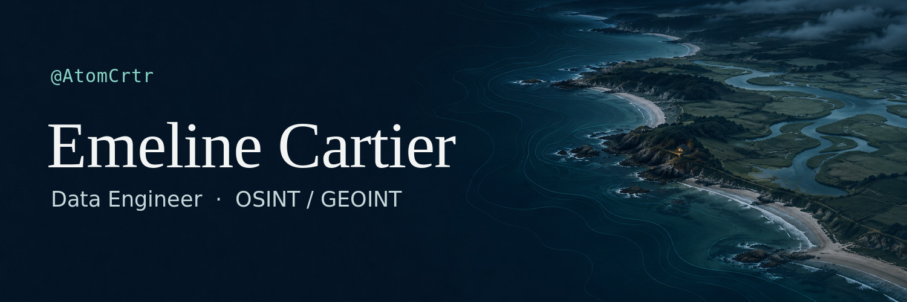

Je suis Data Engineer en alternance dans l’aéronautique, après un parcours en gendarmerie. Je construis des pipelines et des outils d’analyse, avec une attention particulière à la qualité des données et à la provenance des sources. Je développe aussi des projets qui croisent Python, OSINT et analyse criminelle.

[LinkedIn](https://www.linkedin.com/in/emeline-cartier/) · [Dépôts GitHub](https://github.com/AtomCrtr?tab=repositories)

## Projets

### [Open Intelligence Casebook](https://github.com/AtomCrtr/open-intelligence-casebook)

Mon portfolio d’études en sources ouvertes. Quatre dossiers couvrent la chaîne d’approvisionnement du titane, Portal Kombat, les perturbations GNSS et XZ Utils. J’y documente les sources, les recoupements et le niveau de confiance de chaque conclusion.

[Lire le guide des dossiers →](https://github.com/AtomCrtr/open-intelligence-casebook/blob/main/READING_GUIDE.md)

- **[Vesuvius Data Explorer](https://github.com/AtomCrtr/vesuvius-data-explorer-atom)** — Explorer des scans 3D de rouleaux carbonisés et contrôler la géométrie des volumes avec Python, Zarr et napari.
- **[SolarScope](https://github.com/AtomCrtr/SolarScope)** — Un site éducatif pour découvrir l’espace à partir de données de la NASA, de l’ESA et de la NOAA. [Ouvrir l’application →](https://solar-scope.vercel.app)
- **[YouTube Trends](https://github.com/AtomCrtr/youtube-trends-analysis)** — Collecter les tendances via l’API YouTube, les analyser en Python et les visualiser dans Power BI.
- **[CinéMatch](https://github.com/AtomCrtr/movie-recommendation-app)** — Recommander des films à partir de descriptions, avec TF-IDF, similarité cosinus et Streamlit.

## Outils et méthodes

- **Ingénierie data** · Python, SQL, PostgreSQL, DuckDB, Palantir Foundry, tests et CI/CD.
- **Applications et visualisation** · FastAPI, Streamlit, Next.js, TypeScript et Power BI.
- **Analyse en sources ouvertes** · Recoupement des sources, cartographie, chronologies et analyse de liens. Je distingue les faits vérifiés, les hypothèses et les incertitudes.

Formations et certifications

- Palantir Foundry Data Engineer Associate et Foundry &amp; AIP Builder Foundations (2026).
- OSINT au Basel Institute on Governance et OSINT/GEOINT à l’IEGA (2026).
- Prévention des menaces terroristes et de l’extrémisme violent, Assas Executive Education (2026).
- Data Analyst, titre RNCP de niveau 6, Wild Code School (2025).
- Parcours Data Engineer, DataScientest / Mines Paris – PSL Executive Education (en cours).

## Activité GitHub

