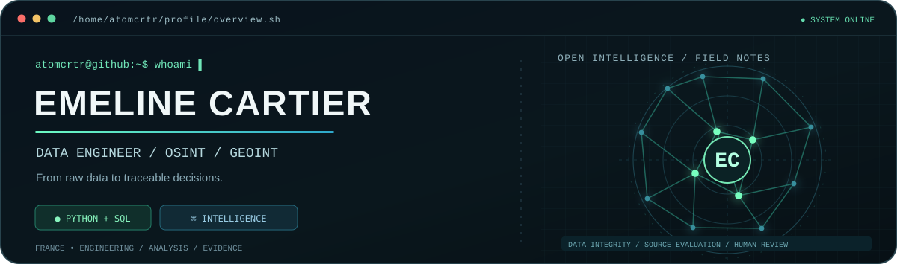
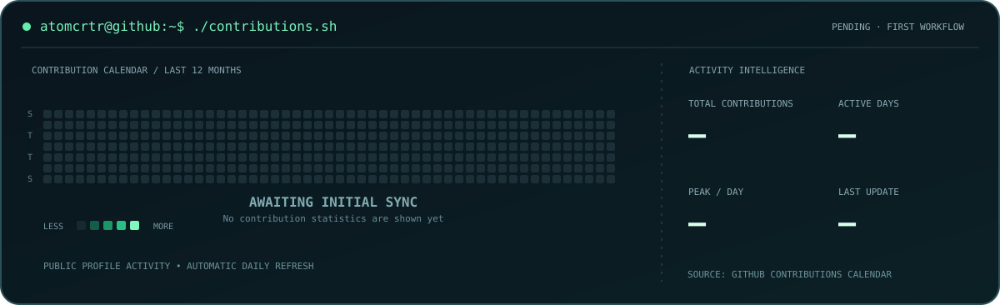

<div align="center">



<br>

**Data Engineering · Open-Source Intelligence · Knowledge Graphs**

*Transformer des sources dispersées en systèmes de données fiables et en analyses traçables.*

[**LinkedIn**](https://www.linkedin.com/in/emeline-cartier/) · [**Portfolio OSINT**](https://github.com/AtomCrtr/open-intelligence-casebook) · [**SolarScope en ligne**](https://solar-scope.vercel.app)

</div>

---

### `> ./mission.sh`

Je conçois des **pipelines data**, des applications et des analyses fondées sur des preuves vérifiables. Mon parcours mêle **ingénierie des données en environnement industriel** et **expérience de terrain en gendarmerie**.

Ma ligne directrice : **la qualité des données, la reproductibilité, le recoupement des sources et la clarté du livrable**. Je m'intéresse en particulier à la rencontre entre **Python, OSINT/GEOINT, graphes et analyse criminelle**.

```text
  INPUT                PROCESS                  OUTPUT
  ───────────          ───────────────────      ───────────────────
  Sources / API   ──►  Collecte & validation ─► Jeux de données fiables
  Indicateurs     ──►  Modélisation / BI     ─► Décisions opérationnelles
  Sources ouvertes──►  Recoupement / analyse ─► Hypothèses & preuves
```

### `> ./contributions.sh`

<div align="center">



<sub>Données issues du calendrier de contributions de GitHub · actualisation automatique quotidienne · aucune statistique inventée.</sub>

</div>

### `> ls ./featured-projects`

<table>
  <tr>
    <td width="50%" valign="top">
      <h3>🧭 <a href="https://github.com/AtomCrtr/open-intelligence-casebook">Open Intelligence Casebook</a></h3>
      <p><b>Portfolio d'analyse OSINT / GEOINT.</b> Quatre dossiers publics : chaîne d'approvisionnement du titane, Portal Kombat, perturbations GNSS et XZ Utils.</p>
      <p><code>Python</code> <code>OSINT</code> <code>GEOINT</code> <code>Analyse structurée</code></p>
      <a href="https://github.com/AtomCrtr/open-intelligence-casebook/blob/main/READING_GUIDE.md">→ Guide de découverte</a>
    </td>
    <td width="50%" valign="top">
      <h3>🔭 <a href="https://github.com/AtomCrtr/SolarScope">SolarScope</a></h3>
      <p><b>Produit éducatif scientifique.</b> Données NASA/ESA/NOAA, visualisations et parcours interactifs, assistant sourcé, tests et CI/CD.</p>
      <p><code>Next.js</code> <code>React</code> <code>TypeScript</code> <code>APIs</code></p>
      <a href="https://solar-scope.vercel.app">→ Voir l'application</a>
    </td>
  </tr>
  <tr>
    <td width="50%" valign="top">
      <h3>📜 <a href="https://github.com/AtomCrtr/vesuvius-data-explorer-atom">Vesuvius Data Explorer</a></h3>
      <p><b>Exploration et contrôle qualité de scans 3D.</b> Chargement partiel de volumes, visualisation dans napari et contrôles géométriques.</p>
      <p><code>Python</code> <code>napari</code> <code>Zarr</code> <code>Data Quality</code></p>
      <a href="https://github.com/AtomCrtr/vesuvius-data-explorer-atom">→ Explorer le dépôt</a>
    </td>
    <td width="50%" valign="top">
      <h3>📈 <a href="https://github.com/AtomCrtr/youtube-trends-analysis">YouTube Trends</a></h3>
      <p><b>Exploration et visualisation de données.</b> Extraction via YouTube Data API v3, analyse Python et dashboard Power BI.</p>
      <p><code>Python</code> <code>API</code> <code>Power BI</code> <code>DAX</code></p>
      <a href="https://github.com/AtomCrtr/youtube-trends-analysis">→ Voir l'analyse</a>
    </td>
  </tr>
</table>

<sub>Autre projet public : <a href="https://github.com/AtomCrtr/movie-recommendation-app">CinéMatch</a> — recommandations de films avec TF-IDF, similarité cosinus et Streamlit.</sub>

### `> cat intelligence-method.md`

> **Decision first. Evidence deep. Human review.**

| Phase | Objectif |
|:---|:---|
| `01 / FRAME` | Transformer le besoin en questions analysables |
| `02 / COLLECT` | Recueillir des sources ouvertes de manière légale et passive |
| `03 / VERIFY` | Évaluer la fiabilité, recouper et documenter la provenance |
| `04 / ANALYZE` | Construire chronologies, graphes, indicateurs et hypothèses concurrentes |
| `05 / DELIVER` | Expliquer le jugement, le niveau de confiance et les limites |

Les études publiées distinguent **faits établis, interprétations et incertitudes**. Les validations techniques ne remplacent pas la relecture du raisonnement.

### `> cat tech-stack.yml`

| Domaine | Outils & méthodes |
|:---|:---|
| **Data Engineering** | `Python` `SQL` `Pandas` `DuckDB` `ETL/ELT` `PostgreSQL` |
| **Applications / API** | `FastAPI` `Streamlit` `Next.js` `React` `TypeScript` |
| **Data Viz / BI** | `Power BI` `DAX` `Looker Studio` `Google Sheets` |
| **Qualité & livraison** | `GitHub Actions` `pytest` `Playwright` `CI/CD` `Traçabilité` |
| **Renseignement ouvert** | `OSINT` `GEOINT` `Analyse de liens` `ACH` `Graphes de connaissance` |
| **Industrie & données** | `Palantir Foundry / Skywise` `Automatisation` `KPI` |

### `> cat learning-path.log`

- **Palantir Foundry Data Engineer Associate** — 2026.
- **Foundry & AIP Builder Foundations** — 2026.
- **Data Analyst — RNCP niveau 6**, Wild Code School — 2025.
- **Open-source Intelligence**, Basel Institute on Governance — 2026.
- **Formations OSINT / GEOINT et renseignement**, IEGA — 2026.
- **Prévention des menaces terroristes et de l'extrémisme violent**, Assas Executive Education — 2026.
- **Parcours Data Engineer**, DataScientest / Mines Paris – PSL Executive Education — en cours.

### `> cat current-focus.txt`

Aujourd'hui, j'approfondis **Python, les architectures de données, FastAPI, l'analyse structurée et les méthodes OSINT**, tout en développant des outils et des publications qui peuvent être **lus, vérifiés et reproduits**.

Mes projets industriels restent décrits à un niveau général : les **données, métriques et livrables métier non publics** ne sont pas publiés.

---

<div align="center">

<sub>**BUILD WITH DATA · INVESTIGATE WITH EVIDENCE · DECIDE WITH CONTEXT**</sub>

<br>

[LinkedIn](https://www.linkedin.com/in/emeline-cartier/) · [Dépôts publics](https://github.com/AtomCrtr?tab=repositories)

</div>